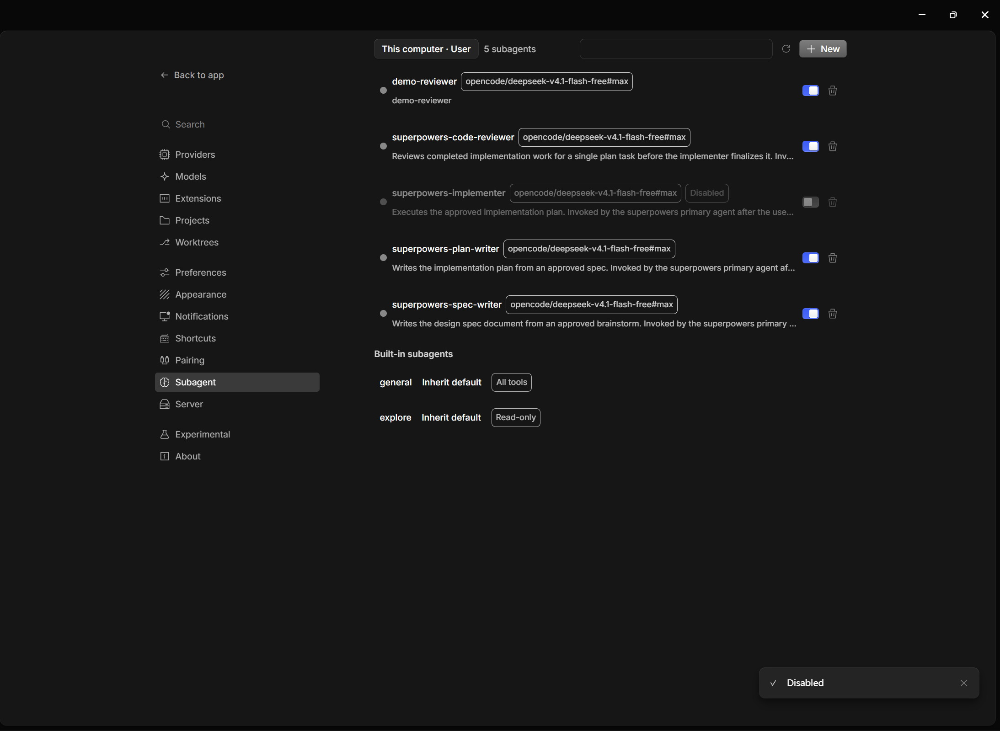
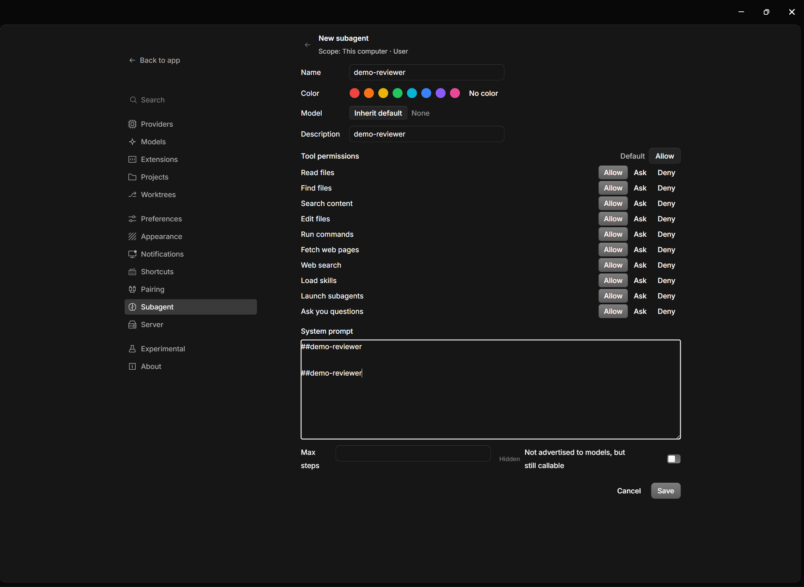

# opencode-subagent-studio

Manage OpenCode V2 subagents from the desktop app: a settings page to view, create, edit, disable, rename and trash subagent markdown files, with live sync for user-level agents and on-demand refresh for project scopes.

> **Translate this README:** this document is maintained in English + Chinese. If you read another language, you are welcome to translate this README with your own AI agent — the text is self-contained and machine-translation friendly.

> **UI dictionary disclaimer:** the plugin ships interface dictionaries for 11 languages (English, 简体中文, Français, Español, Português do Brasil, Русский, العربية, Deutsch, 日本語, हिन्दी, 한국어). They are AI-translated and may read ambiguously; when in doubt, the English copy is authoritative. The settings entry is named "Subagent" in every language.

在 OpenCode Desktop 的设置里管理 V2 子智能体：查看、新建、编辑、停用、重命名、回收站删除；用户级代理实时同步，项目级按需刷新。

> **翻译本 README：** 本文档按英文 + 中文双语维护。如果你习惯其他语言，欢迎用自己的 AI Agent 翻译本 README——正文自包含，适合机翻。

> **界面词典说明：** 插件内置 11 种语言的界面词典（English、简体中文、Français、Español、Português do Brasil、Русский、العربية、Deutsch、日本語、हिन्दी、한국어）。词典由 AI 翻译，个别措辞可能有歧义；如有疑问，以英文文案为准。设置入口在各语言下统一显示为 "Subagent"。

> **Status:** feature-complete for OpenCode Desktop 2.2.5 and verified compatible with 2.2.6. The upstream plugin API is experimental, so a newer desktop release may still break the plugin. It is hosted at <https://github.com/VicChenBike/opencode-subagent-studio>.
>
> **状态：** 面向 OpenCode Desktop 2.2.5 的功能已完成，并已实测兼容 2.2.6。上游插件 API 仍属实验性，更新的桌面端版本仍可能使插件失效。仓库地址：<https://github.com/VicChenBike/opencode-subagent-studio>。

---

## Features / 功能

| | English | 中文 |
|---|---|---|
| **List** | User-level and project-level scopes, case-insensitive alphabetical sort, search, hidden badge, disabled badge | 用户级与项目级作用域、大小写不敏感字母序、搜索、「隐藏」与「已停用」徽标 |
| **Create** | Live ID validation, reserved-ID guard, no-clobber | 实时校验、保留 ID 拦截、存在即拒绝 |
| **Edit** | Description, colour, model with reasoning effort, three-state permission matrix (allow / ask / deny), system prompt, max steps, hidden | 描述、颜色、模型与思考深度、三态权限矩阵（允许/询问/禁止）、系统提示词、最大步数、隐藏 |
| **Rename** | Warning first, then the new ID; refuses an existing target | 先警告再输入新 ID；目标已存在则拒绝 |
| **V1 → V2 migration** | Whole-file conversion per the official rules, previewed before saving; comments and unknown fields preserved | 按官方规则整份转换，保存前预览；注释与未知字段保留 |
| **Trash** | Deletes move to `agents-trash/` beside the agents directory, restorable by hand | 删除移入 agents 目录旁的 `agents-trash/`，可手动恢复 |
| **Built-in overrides** | Switch `general` / `explore` models at runtime through plugin storage; nothing is written to `opencode.jsonc` | 内置代理换模型走插件存储，不写配置文件 |
| **Live sync** | `fs.watch` + 300 ms debounce + `agent.reload()`; user-level directories refresh automatically. In the current build, external changes in a project scope need the Refresh button | `fs.watch` + 300 ms 去抖 + `agent.reload()`；用户级目录自动刷新。当前构建中，项目级目录的外部改动需要点「刷新」 |
| **i18n** | 11 interface languages (en, zh, fr, es, br, ru, ar, de, ja, hi, ko), AI-translated; the settings entry reads "Subagent" in every language | 11 种界面语言（en、zh、fr、es、br、ru、ar、de、ja、hi、ko），词典由 AI 翻译；设置入口在各语言下统一显示 "Subagent" |





## Requirements / 前置要求

- **OpenCode Desktop 2.2.5** — the version this plugin was built against. **2.2.6** has been verified compatible.
- **Node.js 24+ and npm** — needed to install dependencies, run the tests and build the GUI bundle.
- **Windows 11** has been tested. macOS and Linux should work in principle but have not been verified.

- **OpenCode Desktop 2.2.5** —— 本插件的开发基准版本。**2.2.6** 已实测兼容。
- **Node.js 24+ 与 npm** —— 安装依赖、运行测试、构建 GUI bundle 时需要。
- **Windows 11** 已实测；macOS 与 Linux 理论上可用，但尚未验证。

## Compatibility / 兼容性

- **OpenCode Desktop 2.2.5 / 2.2.6** — built against 2.2.5, verified compatible on 2.2.6. The plugin API is marked experimental upstream, so releases beyond that may change it and break this plugin.
- The server half needs a Node-compatible runtime (the desktop ships one). The GUI half is a single CommonJS bundle loaded by the desktop renderer.
- The plugin makes no network requests and collects no telemetry.

- **OpenCode Desktop 2.2.5 / 2.2.6** —— 基于 2.2.5 开发，已在 2.2.6 实测兼容。上游的插件 API 标注为 experimental，更新的桌面端版本可能变化并导致本插件失效。
- 服务端部分需要 Node 兼容运行时（桌面端自带）；GUI 部分是桌面渲染进程加载的单文件 CommonJS bundle。
- 插件不发起网络请求，也不收集遥测数据。

## Install / 安装

1. Clone the repository into the plugins directory, then install and build. If you already have this folder, skip the clone and run the three commands inside it.

```bash
git clone https://github.com/VicChenBike/opencode-subagent-studio ~/.config/opencode/plugins/opencode-subagent-studio
cd ~/.config/opencode/plugins/opencode-subagent-studio
npm install
npm run build
```

`dist/` is gitignored: the plugin will not load from a fresh clone until `npm run build` has produced `dist/gui-experimental.cjs`.

2. Add the **directory** to `opencode.jsonc`. The desktop reads `opencode.jsonc`, not `cli.json`, and the entry must point at the folder (not a file inside it):

```jsonc
{
  "plugins": [
    "<your home>/.config/opencode/plugins/opencode-subagent-studio"
  ]
}
```

Use your platform's path separator and escape backslashes in JSON, for example on Windows: `"C:\\Users\\<you>\\.config\\opencode\\plugins\\opencode-subagent-studio"`.

3. Restart the desktop app fully (quit from the tray, then relaunch — a window reload is not enough because the server half only loads at process start). Open **Settings → Agent capability → Subagent**.

1. 把仓库克隆到插件目录，然后安装并构建。如果你已经拿到这个文件夹，跳过 clone，直接在文件夹里执行下面三条命令。

```bash
git clone https://github.com/VicChenBike/opencode-subagent-studio ~/.config/opencode/plugins/opencode-subagent-studio
cd ~/.config/opencode/plugins/opencode-subagent-studio
npm install
npm run build
```

`dist/` 被 `.gitignore` 忽略：新克隆的仓库必须先执行 `npm run build` 生成 `dist/gui-experimental.cjs`，否则插件无法加载。

2. 把**目录**写进 `opencode.jsonc`。桌面端读 `opencode.jsonc`，不读 `cli.json`；条目必须指向文件夹，不能指向文件夹里的某个文件：

```jsonc
{
  "plugins": [
    "<你的用户目录>/.config/opencode/plugins/opencode-subagent-studio"
  ]
}
```

注意使用当前平台的路径分隔符，并在 JSON 中转义反斜杠。Windows 示例：`"C:\\Users\\<you>\\.config\\opencode\\plugins\\opencode-subagent-studio"`。

3. 完全重启桌面端（从托盘退出后重新启动；仅刷新窗口不够，因为服务端部分只在进程启动时加载）。打开 **设置 → Agent 能力 → Subagent**。

## Usage / 操作指南

### List page / 列表页

- **Scope menu** (top left): switch between `This computer · User` (default) and any project known to the desktop; project agents live in `<project>/.opencode/agents/`. The **count** next to it reflects the currently shown rows, so it shrinks while a search filter is active.
- **Search** filters by ID and description, case-insensitive. **Refresh** re-reads from disk. User-level directories refresh automatically; in the current build, external changes in a project scope need this button.
- **New** opens a blank editor inheriting the current scope. The ID must match `^[a-z][a-z0-9-]{0,63}$` (lowercase letters, digits, hyphens; ≤ 64 chars) and cannot be one of the reserved IDs `build`, `plan`, `general`, `explore`, `compaction`, `title`, `summary`. An existing file is never overwritten.

- **作用域菜单**（左上）：在「本机 · 用户」（默认）与桌面端已知的各项目之间切换；项目级代理位于 `<项目>/.opencode/agents/`。菜单旁的**计数**显示当前实际显示的行数，因此搜索过滤时会随之减少。
- **搜索**按 ID 与描述过滤，大小写不敏感；**刷新**强制从磁盘重读。用户级目录会自动刷新；当前构建中，项目级目录的外部改动需要点这个按钮。
- **新建**打开继承当前作用域的空白编辑页。ID 必须匹配 `^[a-z][a-z0-9-]{0,63}$`（小写字母、数字、连字符，≤64 字符），且不能是保留 ID：`build`、`plan`、`general`、`explore`、`compaction`、`title`、`summary`。已存在的文件绝不会被覆盖。

### Rows / 列表行

Each custom agent row shows a colour dot (theme grey when unset), the name, a model badge (the raw `provider/model` or `provider/model#variant` string; no badge when no model is set), a "Hidden" badge for `hidden: true`, a "Disabled" badge when switched off, plus a per-row switch and trash button. Click a custom agent row to edit it.

每个自定义代理行显示颜色圆点（未设置时用主题灰）、名称、模型徽标（原样显示 `provider/model` 或 `provider/model#variant`；未设置模型时不显示徽标）、`hidden: true` 的「隐藏」徽标、停用后的「已停用」徽标，以及行内开关和垃圾桶。点击自定义代理行进入编辑。

- The **switch** is an enable switch (blue/on = enabled, following the host convention). Toggling it writes `disabled`: a disabled agent stays on disk but is removed from the loaded configuration; its row dims and shows the "Disabled" badge.
- The **trash button** moves the file to `agents-trash/` (see "Restore from trash" below) after a confirmation.

- **开关**是「启用」开关（蓝色/开 = 启用，遵循宿主惯例）。切换写入 `disabled`：停用的代理保留在磁盘上、只是从加载配置中移除，行变暗并显示「已停用」徽标。
- **垃圾桶**经确认后把文件移入 `agents-trash/`（见下文「从回收站恢复」）。

### Built-in group / 内置分组

Pinned at the bottom: `general` ("All tools") and `explore` ("Read-only"). They have no editor and no trash button — only the model can be changed, through the same model picker; choosing "Inherit default" clears the override.

置底显示 `general`（「全部工具」）与 `explore`（「只读」）。它们没有编辑入口、没有垃圾桶——只能通过同一个模型弹窗换模型，选「继承默认」即清除覆盖。

### Editor page / 编辑页

- **Name** is read-only after creation; **Rename** first warns that the agent ID equals the file name, so references to it in prompts or other agents will break, then refuses an ID that already exists.
- **Colour**: eight preset dots plus "none"; writes `color: "#rrggbb"`.
- **Model** opens a picker grouped by provider with a search box; the **reasoning-effort** dropdown next to it lists the selected model's variants. It shows "None" when the model has no variants or when "Inherit default" is chosen. "Inherit default" simply omits `model` from the file.
- **Description** is required — it is what the parent model sees when choosing a subagent.
- **Permissions** is a three-state matrix over ten actions (`read`, `glob`, `grep`, `edit`, `shell`, `webfetch`, `websearch`, `skill`, `subagent`, `question`) plus a default: **allow** = runs normally, **ask** = the user is asked every time, **deny** = refused. Fine-grained rules already in the file are preserved and keep priority (the last matching rule wins).
- **System prompt** is the markdown body; **Max steps** writes `steps` (empty = unset); **Hidden** writes `hidden: true` — the agent stays callable, just not advertised to the model.
- **Saving a V1 file** first opens a side-by-side migration preview; confirming converts the whole file to V2 (see "How it works"). The editor already shows the migration-effective content (a legacy `prompt:` field appears as the body, `model` + `variant` as one reference), so toggling or saving a V1 agent never loses its prompt, variant, max steps or tool denials.
- **Save conflict**: the editor records the file hash when it opens. If the file changed on disk, the save is refused and a dialog offers **Reload** or **Overwrite**. **Reload** (or dismissing the dialog with Esc / a click outside) leaves the editor and returns to the list. **Overwrite** keeps your form and first copies the current disk content to the trash folder as `.backup-<timestamp>-<name>.md`.

- **名称**创建后只读；**重命名**先警告「代理 ID 就是文件名，提示词或其他代理里对它的引用会失效」，再拒绝已存在的目标 ID。
- **颜色**：8 个预设圆点 + 「无颜色」；写入 `color: "#rrggbb"`。
- **模型**打开按 provider 分组、带搜索框的弹窗；旁边**思考深度**下拉列出该模型的 variants。模型没有 variants 或选了「继承默认」时显示「无」。选「继承默认」就是文件里不写 `model`。
- **描述**必填——父模型挑选子代理时看到的就是它。
- **权限**是 10 个 action（read / glob / grep / edit / shell / webfetch / websearch / skill / subagent / question）加一个默认档的三态矩阵：**允许**=正常执行，**询问**=每次问用户，**禁止**=拒绝。文件里已有的细粒度规则会被保留并保持优先（最后一条匹配的规则生效）。
- **系统提示词**就是 Markdown 正文；**最大步数**写 `steps`（留空 = 不设）；**隐藏**写 `hidden: true`——代理仍可被调用，只是不向模型宣传。
- **保存 V1 文件**会先弹左右对照的迁移预览；确认后整份转换为 V2（见「工作原理」）。编辑页显示的已经是迁移后的等效内容（旧版 `prompt:` 字段显示为正文、`model` + `variant` 显示为一条引用），因此对 V1 代理点开关或保存不会丢提示词、variant、最大步数或工具禁用。
- **保存冲突**：打开编辑页时记录文件 hash；若文件在磁盘上被外部改动，保存会被拒绝，弹窗提供**重新加载**或**强制覆盖**。**重新加载**（或按 Esc / 点弹窗外关闭）会离开编辑页返回列表。**强制覆盖**保留你的表单，并先把当前磁盘内容备份进回收站目录（`.backup-<时间戳>-<原名>.md`）。

## How it works / 工作原理

Two cooperating processes:

两个协作的进程：

```
┌───────────────────────────────────────────────┐
│ GUI — desktop renderer (SolidJS)              │
│   src/gui/*  →  dist/gui-experimental.cjs     │
│   settings page: list / editor / model picker │
└───────────────┬───────────────────────────────┘
                │ RPC: 12 methods + "changed" event
┌───────────────▼───────────────────────────────┐
│ Server — Node (runs in the desktop server)    │
│   src/index.ts + src/core/*                   │
│   scans agents dirs, reads/writes markdown,   │
│   fs.watch, V1→V2 migration, builtin override │
└───────────────────────────────────────────────┘
```

**Data flow.** The markdown files under the `agents/` directories are the single source of truth. The server scans them recursively (case-insensitive alphabetical order; only files whose `mode` is exactly `subagent`) and exposes them through the `list` / `read` RPC methods; the GUI renders the result. File mutations (`create` / `update` / `remove` / `rename` / `setDisabled`) write markdown; `setBuiltinModel` writes plugin storage. Every mutation then calls `agent.reload()` and broadcasts the `changed` event. The GUI re-fetches the list on `changed`, except while the editor is open.

**数据流。** agents 目录下的 Markdown 文件是唯一事实源。服务端递归扫描（按 ID 大小写不敏感字母序；只显示 `mode` 精确等于 `subagent` 的文件），经 `list` / `read` RPC 暴露给 GUI 渲染；文件写操作（create / update / remove / rename / setDisabled）落盘，`setBuiltinModel` 写插件存储。所有写操作随后调用 `agent.reload()` 并广播 `changed` 事件；GUI 收到后重拉列表，编辑页打开时除外。

**Live sync.** The server watches the user-level `agents/` directory continuously. The `watchProject` RPC exists and the server can watch a project directory, but the current GUI does not call it, so external changes in a project scope are not picked up automatically — use **Refresh**. Disk changes are debounced for 300 ms (Windows fires several events per save), then trigger `agent.reload()` and a `changed` event. When the editor is open, the page only shows a "Disk changed" toast and does not overwrite the form.

**实时同步。** 服务端常驻监听用户级 `agents/` 目录。`watchProject` RPC 已存在，服务端也能监听项目目录，但当前 GUI 没有调用它，因此项目级目录的外部改动不会自动出现——请点**刷新**。磁盘变化去抖 300 ms 后（Windows 下一次保存会连发多个事件）触发 `agent.reload()` 并广播 `changed`。编辑页打开时，页面只提示「磁盘已更新」，不会覆盖表单。

**V1 → V2 migration.** A file whose frontmatter contains any of `permissions`, `request`, `system`, `disabled` is read as V2 as a whole; anything else is read as V1 (legacy). Saving a V1 file from the editor first shows a side-by-side migration preview: `permission` map → `permissions` rule array, `disable` → `disabled`, `model` + `variant` → `provider/model#variant`, `maxSteps` → `steps`; `name`, `temperature`, `top_p` and `options` are dropped; `tools` entries set to `false` become `deny` rules; V1 action names are renamed (`bash`→`shell`, `task`→`subagent`, `write`/`patch`→`edit`); nested permission values are expanded into multiple rules. The markdown body is kept as-is, except that a non-empty V1 `prompt` is merged into the body when the body is empty. The conversion rewrites the entire file in one pass with the `yaml` Document API, so comments, key order and unknown fields survive.

**V1→V2 迁移。** frontmatter 出现 `permissions` / `request` / `system` / `disabled` 任一字段，整份文件即按 V2 读；否则按 V1（旧格式）读。从编辑页保存 V1 文件时，先弹左右对照的迁移预览：`permission` 映射 → `permissions` 规则数组、`disable` → `disabled`、`model` + `variant` → `provider/model#variant`、`maxSteps` → `steps`；`name`、`temperature`、`top_p`、`options` 被删除；`tools` 中值为 `false` 的项转成 `deny` 规则；V1 动作名改名（bash→shell、task→subagent、write/patch→edit）；嵌套 permission 值展开为多条规则。Markdown 正文默认原样保留，唯一例外是 V1 `prompt` 非空且正文为空时，`prompt` 会并入正文。转换用 `yaml` 的 Document API 一次性重写整份文件，注释、键顺序与未知字段全部保留。

**Built-in overrides.** `general` and `explore` are OpenCode's built-in subagents; the plugin can only change their model. An override is stored in the plugin's own key-value storage (`builtin-model.general` / `builtin-model.explore`) and injected at runtime through `ctx.agent.transform`, which replays after every agent reload. Nothing is written to `opencode.jsonc`, and removing the plugin removes the overrides.

**内置代理覆盖。** `general` 与 `explore` 是 OpenCode 的内置子代理，插件只能换它们的模型。覆盖值存在插件自己的键值存储里（`builtin-model.general` / `builtin-model.explore`），运行时经 `ctx.agent.transform` 注入（每次代理重载后重放）；不写 `opencode.jsonc`，移除插件后覆盖即消失。

**Conflict detection.** Opening the editor records the file's hash. Saving sends that hash back; if the file changed on disk in the meantime the server refuses with `conflict` and the GUI offers **Reload** (leave the editor and return to the list) or **Overwrite** (keep the form). Dismissing the dialog also leaves the editor. Forcing the overwrite first copies the current file into the trash folder as `.backup-<timestamp>-<name>.md`. All writes are atomic (temporary file + rename in the same directory), so a crash or full disk mid-write cannot truncate an agent file. Existing files keep their original line endings (LF or CRLF), and a UTF-8 BOM is dropped on the first write.

**冲突检测。** 打开编辑页时记录文件 hash；保存时回传该 hash，若磁盘文件在此期间被外部改动，服务端返回 `conflict`，GUI 提供**重新加载**（离开编辑页返回列表）或**强制覆盖**（保留表单）；关闭弹窗也会离开编辑页。强制覆盖前先把当前文件备份进回收站目录（`.backup-<时间戳>-<原名>.md`）。所有写入都是原子的（同目录临时文件 + rename），写入中途崩溃或磁盘满不会截断代理文件。已有文件写回时保留原始行尾（LF 或 CRLF），UTF-8 BOM 会在首次写入时去掉。

## Limitations / 局限性

Honest list of what this plugin does not do:

- **Local scopes only** — no remote devices or SSH projects; "user" and "project" both mean this machine. 仅本机作用域——没有远程设备或 SSH 项目，「用户」「项目」都指本机。
- **`mode: all` agents are not listed** — the list shows only files whose `mode` is exactly `subagent`. `mode: all` 的代理不显示——列表只显示 `mode` 精确为 `subagent` 的文件。
- **Project-level live sync is not wired in the current build** — the `watchProject` RPC exists, but the GUI does not call it. External changes in a project scope need the Refresh button. 当前构建中项目级实时同步未接线——`watchProject` RPC 已存在，但 GUI 没有调用它；项目级目录的外部改动需要点「刷新」。
- **Project scopes depend on the desktop's project list** — a project the desktop has not indexed cannot be selected. 项目级作用域依赖宿主项目列表——桌面端未索引到的项目无法选择。
- **A V1 file is always migrated whole on first save from the editor** — the plugin cannot keep a file in the legacy V1 format. V1 文件首次从编辑页保存时必整份迁移——插件不能让文件保持旧版 V1 格式。
- **No restore UI for the trash** — restoring is manual: move the file back into `agents/`. 回收站没有恢复界面——恢复靠手动：把文件移回 `agents/`。
- **Renaming breaks references** — the agent ID is the file name; prompts or other agents that call it by ID must be updated by hand. 重命名会断引用——代理 ID 就是文件名，提示词或其他代理里按 ID 调用它的地方需要手动更新。
- **Nested agent files are listed but cannot be created from the UI** — a file at `agents/team/reviewer.md` is shown with ID `team/reviewer` and can be edited; the New/Rename dialogs only accept flat IDs, and renaming a nested agent keeps it in its subfolder. 嵌套代理文件会显示但不能从 UI 新建——`agents/team/reviewer.md` 会以 `team/reviewer` 显示并可编辑；新建/重命名输入框只接受扁平 ID，重命名嵌套代理时文件仍留在原目录。
- **The host plugin API is experimental** — a newer OpenCode Desktop may change it and break this plugin (built against 2.2.5, verified on 2.2.6). 宿主插件 API 是实验性的——更新的桌面端可能变化并导致本插件失效（基于 2.2.5 构建，2.2.6 已验证）。
- **Built-in overrides live in plugin storage** — disabling or removing the plugin restores OpenCode's default models for `general` / `explore`. 内置覆盖仅存于插件存储——停用或移除插件后，`general` / `explore` 恢复 OpenCode 默认模型。

## Troubleshooting / 排障

- **The settings page is missing.** Check that `opencode.jsonc` has the plugin **directory** (not a file) in `plugins`, that the desktop reads `opencode.jsonc` rather than `cli.json`, and that you fully restarted the app. On Windows, if the plugin silently fails to load, kill any leftover `opencode-cli.exe` processes and relaunch.
- **Server changes do not take effect.** `src/index.ts` and `src/core/*` load only at process start: quit the desktop fully and relaunch. A window reload is not enough.
- **GUI changes do not take effect.** Run `npm run build` (or keep `npm run watch` running), then reload the desktop window.
- **The list is empty.** Only files whose `mode` is exactly `subagent` are listed; `primary`, `all` and files without `mode` are excluded. Also check that you are in the expected user/project scope.
- **External changes in a project scope do not appear.** This is a known limitation in the current build: project-level live sync is not wired. Click **Refresh**.
- **A save reports a conflict.** The file changed on disk after you opened the editor. Choose **Reload** to discard your form and return to the list (which refetches), or **Overwrite** to keep your form; overwrite first creates a `.backup-` copy in `agents-trash/`.
- **A save reports invalid frontmatter.** The file's YAML has a structural defect (duplicate keys, bad indentation, unclosed quote). The plugin refuses to write rather than risk corrupting it; fix the YAML in a text editor, then save again.
- **`npm test` fails with `MODULE_NOT_FOUND` on Windows.** Use `npm test` (the script uses the glob `test/**/*.test.ts`); do not run `node --test test/` with a directory argument.
- **`npm install` is slow or fails.** Try the official registry: `npm install --registry=https://registry.npmjs.org`.

- **设置页不出现。** 检查 `opencode.jsonc` 的 `plugins` 里是否是插件**目录**（不是文件）、桌面端读的是 `opencode.jsonc` 而不是 `cli.json`，并且确实完全重启过。Windows 上如果插件静默不加载，先杀干净残留的 `opencode-cli.exe` 再启动。
- **服务端改动不生效。** `src/index.ts` 与 `src/core/*` 只在进程启动时加载：完全退出桌面端再启动，仅刷新窗口不够。
- **GUI 改动不生效。** 执行 `npm run build`（或保持 `npm run watch` 运行），然后重新加载桌面端窗口。
- **列表是空的。** 只显示 `mode` 精确为 `subagent` 的文件；`primary`、`all`、没有 `mode` 的文件都会被排除。也请确认当前用户级/项目级作用域是否正确。
- **项目级目录的外部改动不出现。** 这是当前构建的已知限制：项目级实时同步未接线。点**刷新**。
- **保存时提示冲突。** 打开编辑页后文件在磁盘上被改动过。选**重新加载**放弃表单并返回列表（列表会重拉），或选**强制覆盖**保留表单；强制覆盖会先在 `agents-trash/` 生成 `.backup-` 副本。
- **保存时提示 frontmatter 格式有误。** 文件的 YAML 有结构缺陷（重复键、坏缩进、未闭引号）。插件拒绝写入以免损坏文件；请先在文本编辑器里修复 YAML，再回来保存。
- **Windows 上 `npm test` 报 `MODULE_NOT_FOUND`。** 用 `npm test`（脚本里是 `test/**/*.test.ts` 的 glob）；不要用目录形式 `node --test test/`。
- **`npm install` 很慢或失败。** 试试官方 registry：`npm install --registry=https://registry.npmjs.org`。

## Development / 开发

```bash
npm install       # install dependencies
npm test          # unit tests (node --test with type stripping)
npm run typecheck # tsc --noEmit
npm run build     # single-file CJS bundle at dist/gui-experimental.cjs
npm run watch     # rebuild the GUI on change; server changes need an app restart
```

The build must produce exactly one file in `dist/`. Modules the desktop provides (`solid-js`, `solid-js/web`, `@opencode/plugin/gui`, `@opencode/plugin/rpc`) stay external; the build fails if anything else from those families is bundled. The GUI bundle must contain no dynamic imports.

构建产物在 `dist/` 内必须只有一个文件。桌面端提供的模块（`solid-js`、`solid-js/web`、`@opencode/plugin/gui`、`@opencode/plugin/rpc`）保持 external；若误打包同族模块，构建会失败。GUI bundle 内不能有动态 import。

## Restore from trash / 从回收站恢复

Deleted agents move to the trash folder beside the agents directory:

- User level / 用户级：`~/.config/opencode/agents-trash/`
- Project level / 项目级：`<project>/.opencode/agents-trash/`

Files are named `<yyyyMMdd-HHmmss>-<original-name>.md`; when two same-named files land in the same second, a `-1`, `-2`… suffix is inserted before `.md` so neither copy overwrites the other. Move the file back into `agents/` to restore it. **Drop the timestamp prefix to keep the original agent ID**; keeping it changes the ID (the file name is the ID). There is no restore UI in this version, and moving a file back does not ask before overwriting an existing file — check the target name first.

文件名形如 `<yyyyMMdd-HHmmss>-<原名>.md`；同一秒内出现两个同名文件时，会在 `.md` 前插入 `-1`、`-2`… 后缀，两份都不会互相覆盖。把它移回 `agents/` 即可恢复。**建议去掉时间戳前缀以保持原代理 ID**；保留前缀会改变 ID（文件名就是 ID）。本版本没有恢复界面；手动移回时不会询问是否覆盖同名文件，请先确认目标文件名。

## Uninstall / 卸载

1. Remove the plugin directory entry from the `plugins` array in `opencode.jsonc`.
2. Fully restart the desktop app.
3. Optionally delete the plugin folder. Your agent markdown files and `agents-trash/` are not touched; built-in model overrides disappear with the plugin.

1. 从 `opencode.jsonc` 的 `plugins` 数组里删掉插件目录条目。
2. 完全重启桌面端。
3. 可选：删除插件文件夹。你的代理 Markdown 文件与 `agents-trash/` 不会被删除；内置模型覆盖会随插件一起消失。

## Data and privacy / 数据与隐私

The plugin reads and writes only:

- the markdown files under the agents directories above;
- files in `agents-trash/` (deleted agents and `.backup-` copies made before a forced overwrite);
- one key per built-in override in the plugin's own storage (`builtin-model.general`, `builtin-model.explore`).

It makes no network requests and collects no telemetry.

插件只读写：

- 上述 agents 目录里的 Markdown 文件；
- `agents-trash/` 里的文件（删除的代理，以及强制覆盖前生成的 `.backup-` 副本）；
- 插件存储中每个内置覆盖一个键（`builtin-model.general`、`builtin-model.explore`）。

插件不发起网络请求，不收集遥测数据。

## License / 许可

MIT. See [LICENSE](LICENSE).

MIT。见 [LICENSE](LICENSE)。

## Acknowledgements / 致谢

- [opencode-agent-models](https://www.npmjs.com/package/opencode-agent-models) for the shape of a model-picker plugin and the pattern of storing overrides outside the config file. (This project has no public GitHub repository; the npm page is the canonical link.)
- [ZCode](https://github.com/zai-org/ZCode) for the settings page layout this UI follows (scope menu, count, row badges, built-in group).
- The OpenCode team for the plugin SDK and its documentation.

- 参考 [opencode-agent-models](https://www.npmjs.com/package/opencode-agent-models) 的模型选择插件形态与「覆盖值存在插件侧」的做法。（该项目没有公开 GitHub 仓库，npm 页是正式链接。）
- 参考 [ZCode](https://github.com/zai-org/ZCode) 的设置页布局（作用域菜单、计数、行内徽标、内置分组）。
- 感谢 OpenCode 团队提供插件 SDK 与文档。
